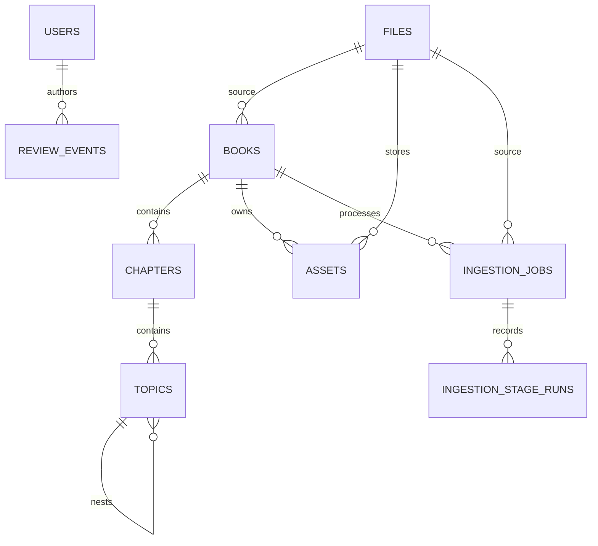

# Data model

Books are edition-specific publication units. Chapters and nested topics hold exact extracted text, ordered JSON content blocks, review state, confidence, and hashes. Assets point to content-addressed files. Ingestion jobs and stage runs provide resumability and diagnostics. Review events retain before/after audit snapshots.
